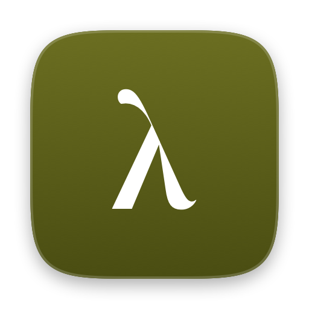
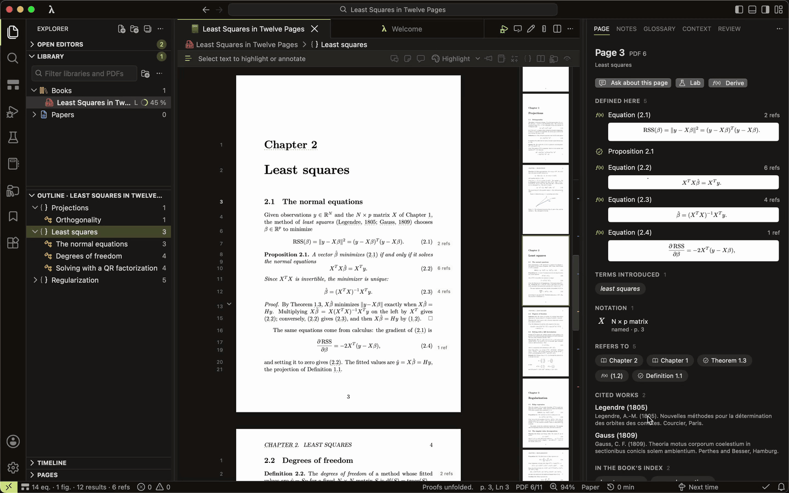
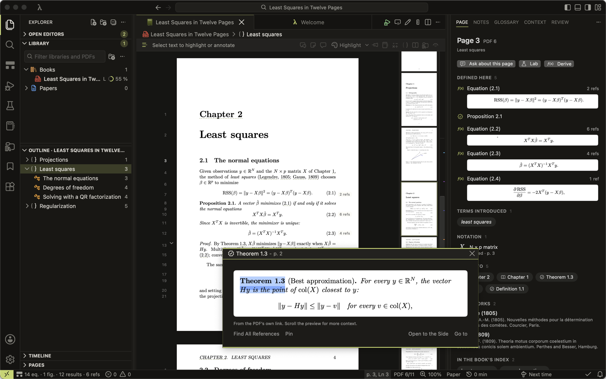
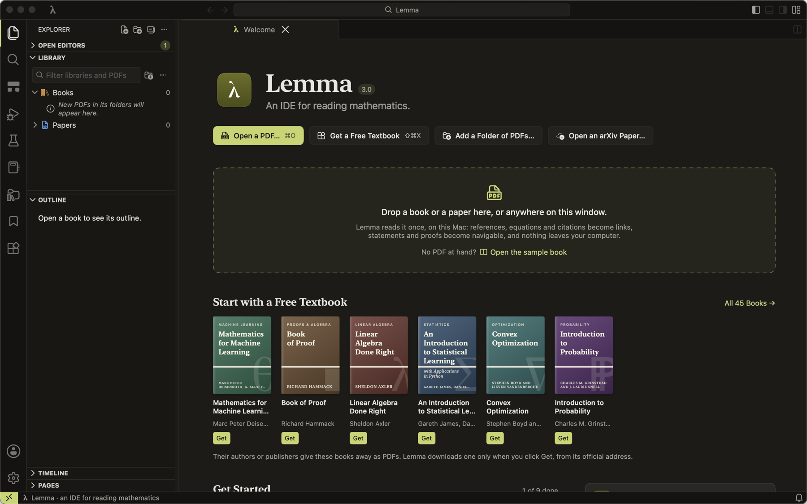

<p align="center"></p>

<h1 align="center">Lemma</h1>

<p align="center"><b>An IDE for reading mathematics.</b><br>
A free, open-source PDF reader for the Mac that understands textbooks and papers the way an editor understands code.</p>

<p align="center"><a href="https://github.com/SonglanNie/lemma/releases/latest/download/Lemma.dmg"><b>Download for macOS</b></a> · macOS 15 or later, Apple silicon and Intel</p>

<p align="center"><sub>Lemma is not notarized yet, so the first time you open it macOS says it cannot verify it: click <b>Done</b>, then <b>System Settings › Privacy &amp; Security › Open Anyway</b>. Only once.</sub></p>

<p align="center"></p>

Open any mathematics, statistics or computer science PDF. Lemma reads it once, on your Mac, and the page becomes navigable: “Theorem 2.3”, “(3.44)”, “Figure 5”, “[12]” and index entries turn into links you can preview, peek at and follow without losing your place.

## About this fork

This is a modified version of [Lemma](https://github.com/fus3r/lemma) by its contributors, based on Lemma 3.4.0. It was changed by Songlan Nie, starting on 18 October 2026, and remains free software under the GNU GPL v3. The commit history records every change. In brief:

- **Windows.** Lemma can have several windows, each with its own tabs, panels and layout (**File › New Window**, ⇧⌘N). A new window takes the side bars, panel and sizes of the window it comes from. Drag a book's tab out of its window to open it in a new window there, onto another window's tabs or page to move it into that window, or choose **Move Tab to New Window** from the tab's menu. A book is open in one window at a time: opening it from another window brings its window to the front. Lemma reopens its windows as you left them.
- **Open to the Side.** Keep any part of a page in view beside the one you are reading: a figure, a table or a passage, even one a page above. ⌘-drag a box around it, or use the small arrow beside the split editor button: **This Page** (⌘\\), **Selection** and **Draw a Box…** (also in the View menu and the page's right-click menu). The side editor opens on the box, fitted to its width, and the rest of the page is still there to scroll to. ⌘-click still looks a word up.
- **Floating boxes.** ⇧⌘-drag a box around anything on the page, in the main editor or the side editor, or click the picture-in-picture button beside the split editor button, and it opens in a small window of its own over the place it came from, at the same size and zoom. Drag the window's edge and the box scales with it, staying sharp; pinch, ⌘-scroll, ⌘+ and ⌘− zoom within it, ⌘0 returns to the whole box. Keep several, from several books: they float above every Lemma window, hide while another app is in front, stay open when you switch tabs or close their book, and come back when Lemma is opened again. The button's arrow has **Hide All** / **Show All** and **Close All**.
- **Zoom.** Hold ⌘ and scroll to zoom with a mouse, in the main editor, the side editor, peeks and floating boxes: scrolling up the page zooms in, and the point under the pointer stays where it is. As in PDFgear, each notch zooms by the same 19%, however fast the wheel turns and whatever distance the mouse and its software give a notch, so the free-spinning wheel of an MX Master, at 60 notches a second, goes from 10% to 10000% in under a second. Each step is drawn sharp, as in PDFgear, with the line numbers and reference counts beside the text kept at their size; the rest of the window, such as the zoom in the status bar, takes in the new zoom once the wheel stops. Opening or closing the side editor, a notebook or a derivation, changing the layout or resizing a side bar no longer changes the page's zoom. A page opened to the side starts fitted to the width of its text rather than its paper, so the blank margins do not make it small; each side tab keeps the zoom you give it.
- **Find.** The find box (⌘F) keeps each book's own query. Switching tabs no longer searches the other book for it and moves that book's page to its match: the field shows that book's query, if it has one, and nothing is searched until you press Return or ⌘G.
- **Updates.** This fork's build has no Sparkle update feed, so an upstream release never installs over it. **Lemma › Check for Updates…** reports a newer release of this fork and opens its page. **Help › Report an Issue…** opens an issue here.

Releases of this fork are named after the upstream version they are based on, with a number of their own: `v3.4.0-fork.1`, `v3.4.0-fork.2`, and so on. To release, set `CFBundleShortVersionString` in [package-app.py](scripts/package-app.py) to the new version, write its notes in `docs/releases/v<version>.md`, commit both and push a tag `v<version>`. GitHub Actions then builds the app for Apple silicon and Intel and publishes it as a release with its disk image, under its version's name and as `Lemma.dmg` for the download link above ([release.yml](.github/workflows/release.yml)). This copy is still called Lemma and uses the same app identifier, so installing it replaces the original Lemma, keeping your library and settings.

A build with only the Command Line Tools (no Xcode) works for Apple silicon with `swift build -c release --disable-keychain && scripts/build-app.sh`.

## What Lemma does

**References you never have to hunt for.** Hover a reference to preview it, click to peek at it beside the line you are reading, ⇧-click others to keep several peeks in sight, ⌘-click a term to look up its definition. Back (⌥⌘←) returns you to where you were. Citations open their entry in the bibliography and can find the paper online when you ask.

**The structure of the text.** An outline of the book's definitions, theorems and proofs; proofs you can fold to try them yourself first; what a result uses and what uses it; a map of a chapter's dependencies; the notation in force on each line; and a header that tells you which statement you are in.

**Proofs, stepped through like a debugger.** Put the reading line in a proof and press F5: step over lines, step into the result a line cites, step out again, with the statement being proved and the symbols in scope beside you.

**Derivations checked as you write them.** Select a step the book calls "easily seen", press ⌥⌘E and write the missing lines in LaTeX. Each line is checked at once with random values of the right shapes (scalars, vectors, matrices), so a wrong step comes with a counterexample and a name: sign error, factor of 2, transposed.

**Python beside the page.** Send an equation to a notebook and run it on your Mac's own Python, gently on the battery. Figures can be pinned in the margin.

**Your work, kept with the source.** Notes, highlights, margin notes and handwriting stay linked to the exact passage. Recall definitions and theorems on a spaced schedule, collect passages from several books into research projects, and export everything: Markdown, Anki decks, Jupyter notebooks, or your annotated edition as a PDF.

**Questions with the right context.** Select a passage and press ⌘K. Lemma assembles the passage, the equations it cites and your notation, shows you the draft, and asks ChatGPT, Codex, Claude Code, or OpenAI, Anthropic or Google with your own API key. Answers return to the note that asked; their algebra can be checked step by step.

**Everything else a reader needs.** Find in the book (⌘F) and search across your whole library, OCR for scanned pages, 45 free textbooks one click away, arXiv search, a minimap of your pages, Paper, Sepia and Night pages, and the choice between a VS Code-style workbench (Lemma's own themes, more than 80 VS Code themes, or any VS Code theme you install) and a classic Mac window.

<p align="center"></p>

<p align="center"></p>

## Install

Download [Lemma.dmg](https://github.com/SonglanNie/lemma/releases/latest/download/Lemma.dmg) (the [latest release](https://github.com/SonglanNie/lemma/releases/latest) has it under its version's name too), open it and drag Lemma into Applications. Lemma runs on macOS 15 (Sequoia) or later, on Apple silicon and Intel Macs.

This build is not yet notarized by Apple, so the first time you open it macOS says it cannot verify it. Click **Done**, then open **System Settings › Privacy & Security** and click **Open Anyway** next to Lemma (or run `xattr -dr com.apple.quarantine /Applications/Lemma.app`). You only do this once.

To see what Lemma does without a PDF at hand, choose **Help › Open the Sample Book**: a twelve-page book on least squares, written to show the links, the structure, the proof debugger and the derivation checker.

**Lemma › Check for Updates…** tells you when a newer release is out and opens its page; install it the same way. Settings › Updates can check once a day.

## Privacy

Lemma has no account, no analytics and no tracking. Your books, notes and reading history stay on your Mac. It goes online only when you click something that says where it goes: downloading a free book, searching arXiv, looking up a cited paper, asking an assistant, checking for updates. [PRIVACY.md](PRIVACY.md) lists every case and what is sent.

## Build it yourself

```sh
git clone https://github.com/SonglanNie/lemma.git && cd lemma
scripts/build-app.sh && open build/Lemma.app
```

You need macOS 15 and Xcode 16 or later. [CONTRIBUTING.md](CONTRIBUTING.md) explains the layout of the code, the tests and how to contribute.

## Learn more

- [Using Lemma](docs/GUIDE.md): reading, notes, OCR, recall, questions and exports in detail.
- [Libraries](docs/LIBRARIES.md): folders, renames, drag and drop, arXiv.
- [Assistants](docs/ASSISTANTS.md): ChatGPT, Codex, Claude Code and API keys, and what each receives.
- [The Lemma Tour](docs/TUTORIAL.md), [design notes](DESIGN.md), [changelog](CHANGELOG.md) and [history](docs/HISTORY.md).

Found a bug or have an idea? Use **Help › Report an Issue…** in Lemma or [open an issue](https://github.com/SonglanNie/lemma/issues).

## License

Lemma is free software under the [GNU General Public License, version 3](LICENSE). It bundles Codicons (CC BY 4.0), colour themes from VS Code and their community authors (MIT, Apache 2.0), KaTeX (MIT) and its fonts (SIL Open Font License 1.1), Marked (MIT), DOMPurify (Apache 2.0) and Sparkle (MIT), which this fork's builds do not use for updates; **Help › Acknowledgements** shows every licence. Free textbooks in the catalog are downloaded from their authors' or publishers' sites and remain under their own terms.
